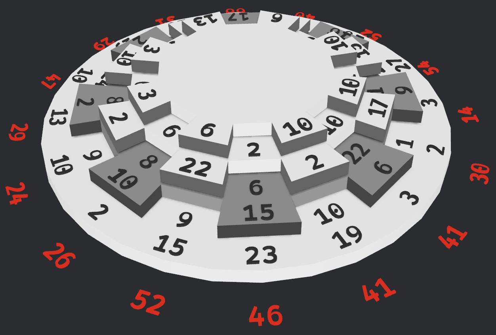

# Wheel Puzzle
The game consists of four, differently-sized discs which are stacked on top of each other.
The discs can be independently rotated.
The discs form 16 columns of four numbers each.



Goal: Rotate the discs in such a way that each of the 16 columns get the same sum.

## Start
Run `cargo run --bin wheel` to start the game.

## Controls
### Keyboard
One disc is actively selected shown in darker gray.
Its rotation can be controlled.

The selected disc can be switched.

| Key | Action |
|---:|:---|
| `S`       | Toggle visibility of column sums |
| `UP`      | Select the disc above (wraps from top to bottom)|
| `DOWN`    | Select the disc below (wraps from bottom to top)|
| `LEFT`    | Rotate selected disc clockwise |
| `RIGHT`   | Rotate selected disc counter-clockwise |

### Mouse
Move around to find a better perspective.

| Mouse | Action |
|---:|:---|
| Scroll wheel      | Zoom in and out |
| Left-click drag   | Rotate the camera view |

## Programmatically Finding Solution
If you want to program a solution instead of manually trying, feel free to copy these disc numbers 
for initialization:

- _alternating refers to the disc ring where number and empty slot alternate only giving eight numbers_
- _top disc only has one alternating ring_
- _bottom disc has two complete rings consisting of 16 numbers_
``` Rust
- top disc:
    - alternating: [10, 6, 13, 3, 3, 6, 10, 10]
- upper middle disc
    - complete:    [6, 10, 4, 1, 5, 5, 4, 8, 6, 3, 1, 6, 10, 6, 10, 2]
    - alternating: [2, 17, 15, 14, 5, 10, 2, 22]
- lower middle disc
    - complete:    [8, 24, 8, 3, 6, 15, 22, 6, 1, 1, 11, 27, 14, 5, 5, 7]
    - alternating: [2, 10, 15, 6, 9, 16, 17, 2]
- bottom disc
    - inner:       [22, 9, 5, 10, 5, 1, 24, 2, 10, 9, 7, 3, 12, 24, 10, 9]
    - outer:       [2, 15, 23, 19, 3, 2, 3, 27, 20, 11, 27, 10, 19, 10, 13, 10]
```

### Solution
<details>
<summary>If you want to peak, click here</summary>

You can run `cargo run --bin riddle` to run a solving algorithm on the given numbers set and print 
out the solution.

> _There is only one solution._
</details>

